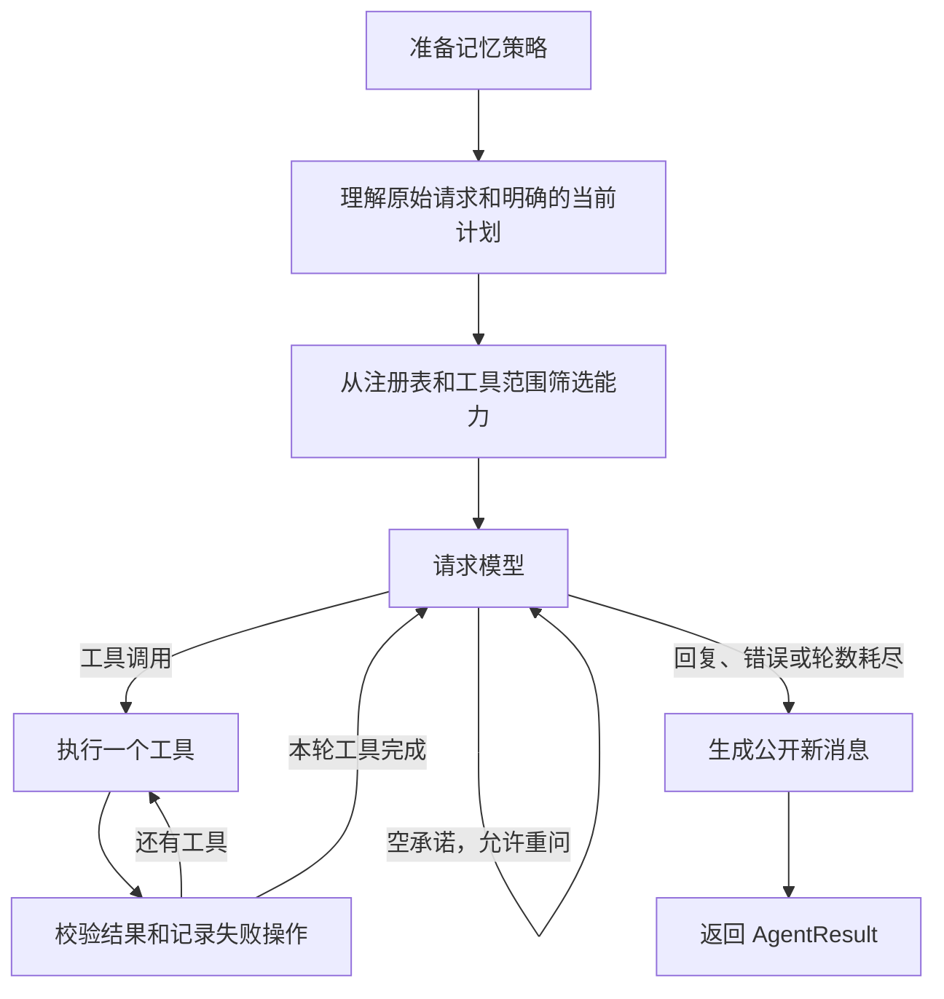

# Agent 核心中文导读

现在只有 `agent/` 一套执行核心。HTTP 和 CLI 都调用 `run_turn`，没有第二套循环、继承执行器或旧目录转发。

## 推荐阅读顺序

1. `agent/state.py`：先认识请求、状态、结果，以及携带部分结果的异常。
2. `agent/context.py`：哪些是本轮连接、权限、工具范围和资源。
3. `agent/runner.py`：核心唯一入口，怎样构造状态、运行图并返回结果。
4. `agent/graph.py`：只看流程和分支。
5. `agent/nodes.py`：逐个理解实际执行步骤。
6. `tooling/`、`infrastructure/`：工具契约及外部服务适配。
7. `service/chat.py`、`service/cli.py`：两个产品入口怎样使用同一个核心。

## 三类数据为什么分开

`AgentRequest` 是输入：原始文字、公开历史和当前计划。调用者已经知道当前计划，就直接提供，核心不再从一段提示词 JSON 中解析回来。

`AgentState` 是图的中间快照：模型工作消息、理解、轮数、工具队列、失败操作和结果。里面只有普通数据，连接、回调和日志留在 `AgentContext`。这为后续将图作为子图或接入检查点留下了清晰边界；现在尚未启用检查点。

`AgentResult` 是本轮产物：答复、状态、公开新消息、工具事件、最新计划和记忆写入结果。`new_messages` 与模型消息独立，长对话压缩不会再让 API 用旧下标漏存回复。

## 一次请求经过哪些步骤

- `prepare` 先判断记忆策略，再读取文件；要求忽略历史时不读取或提取记忆。
- `understand` 识别目标、领域和槽位。模糊指代由收到完整上下文的模型处理，不额外发送一次模型猜测请求。
- `route` 从唯一注册表选择工具，并与服务端提供的 `allowed_tools` 求交集。未知旅行意图默认只开放必要读取工具。
- `model` 调用模型适配器，保留网络重试、备用模型、认证恢复和流式降级。模型决策最多 8 轮，与网络重试次数分开计数。
- `tools` 一次调用一个工具，经过唯一 `ToolExecutor` 的范围、权限和 schema 校验，不直接调用 MCP。写入失败不会被自动重跑。
- `verify` 将业务失败交回模型，允许模型修正参数。只有确实关联的重试成功才能解除失败。
- `finish` 产生公开消息；内部工具 JSON、护栏和调用前说明不会被当成用户可见回复保存。

## 工具注册和结果边界

MCP 定义与 `tools/catalog.py` 的领域元数据转换成 `ToolSpec`，进入唯一 `ToolRegistry`。异步本地工具也注册为相同契约。MCP 适配器不维护另一个注册表。

`ToolExecutor` 校验范围、权限和完整 JSON Schema 后调用 handler。`ToolResult` 是核心唯一结果类型，保留数据、成功状态和错误原因。MCP 的 `isError`、文本错误、`success=false` 都在边界处理；旅行特定的空候选、审计问题等由 `service/travel/` 判断。

每个操作有本轮唯一的 `operation_id`。如果修正参数，模型使用 `_retry_of` 指向失败操作；该字段只是 Agent 内部元数据，在调用实际 handler 前移除，不改变对外 MCP 工具参数。不能按工具名清除失败，否则添加 B 成功会错误掩盖添加 A 失败。

风险说明不是已经完成的用户审批。现在没有批准界面、恢复接口或来自用户输入的 `confirmed` 通行证；后续审批应接在真实工具执行前的节点边界。

## HTTP 与 CLI 各自负责什么

`service/chat.py` 读取数据库会话及当前计划，调用核心，再保存明确的新消息并构造导航动作。HTTP 路由和状态码位于 `service/api/server.py`，不再组织模型内部消息。

`service/cli.py` 负责命令行参数、输入、退出、用量展示和公开历史。它也提供显式当前计划，调用相同的 `run_turn`。命令行的日志会话 ID 仍不自动恢复之前的聊天历史。

`infrastructure/mcp.py` 统一管理连接生命周期。核心不创建或关闭调用者的连接，因此工具注册表只能在连接上下文内使用。HTTP 在 MCP/AnyIO 上下文退出前保存部分结果，避免异常被包装后遗漏保存。

## 异常与取消

普通模型或工具失败是可检查的结果；未恢复的失败不会被标为全部完成。意外异常通过 `AgentRunError.partial_result` 携带已经完成的产物，应用服务可以保存计划关联和中断说明。

`AgentCancelledError` 继承取消异常并携带部分结果，仍终止本轮任务，不转换成下一轮工具失败继续执行。模型工作上下文和进程内日志不等于持久化检查点；进程重启恢复仍是后续工作。

## 后续怎样接多 Agent

当前留下的是已经使用并测试过的契约，没有增加空基类或协调器：

1. 协调者注册一个异步 `ToolSpec.handler`。
2. handler 用 `AgentRequest` 和独立 `AgentContext` 调用同一个 `run_turn`。
3. 子任务设置自己的模型、`allowed_tools`、`max_rounds`；通常关闭记忆写入。
4. 将子任务的 `AgentResult` 转为结构化工具结果，交回协调者。

`tests/test_agent_runner.py` 已验证嵌套调用、能力范围和并发状态隔离。实际多 Agent 的总预算、授权委派、任务合并和副作用归属仍需单独设计；这些接口不代表现已完成多 Agent 调度。

## 验证与已知范围

运行 `uv run --locked python -m unittest discover -s tests`。测试使用假模型/连接及临时文件，覆盖压缩后保存、工具与参数失败、空承诺、轮数限制、重试、取消、MCP 协议快照和依赖方向。

存储路径及现有数据格式保持不变。当前中期记忆仍是单用户全局文件，不提供用户隔离，也没有按当前计划过滤；真实模型、MySQL 和地图联调需要另行运行并记录结果。
