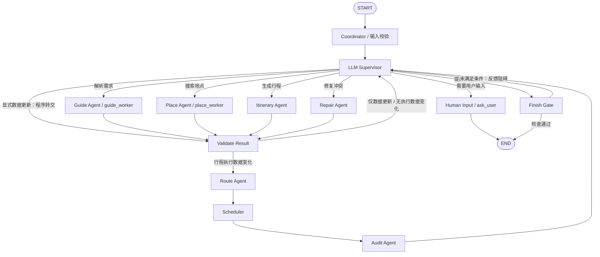

# 旅行规划 Supervisor + Specialists Implementation Plan

> **For agentic workers:** REQUIRED SUB-SKILL: Use superpowers:executing-plans to implement this plan task-by-task. Steps use checkbox (`- [ ]`) syntax for tracking.

**Goal:** 在现有旅行规划 Graph 上增加受限调度、可拒绝的地点匹配和保留原草稿的局部修复，并能从测试与日志区分输入、模型、工具、业务规则、状态和流程错误。

**Architecture:** 按用户提供的 `mermaid-diagram.png` 改为中央调度：Coordinator 后立即进入 Supervisor，由它调度 Guide、Place、Itinerary、Repair；四类结果统一进入 Validate Result。仅数据更新返回 Supervisor，影响行程执行的数据变化强制经过 Route → Schedule → Audit 再返回 Supervisor；Finish Gate 失败也返回 Supervisor，Human Input 保存进度后结束本次请求。复用现有业务函数、计划结构、模型客户端和 MySQL，不要求旧 14 个节点继续全部暴露在顶层图。

**Tech Stack:** Python 3.10+、现有 LangGraph 1.x、jsonschema、unittest、unittest.mock、httpx.MockTransport、MySQL、React。

**Spec:** 目标拓扑以本轮用户提供的 `C:/Users/wyk/Downloads/mermaid-diagram.png` 为准，第 1 节将其转为可编辑 Mermaid。延续 `docs/superpowers/specs/2026-10-30-agent-graph-responsibilities-design.md` 的数据真实性、完整覆盖地点、固定锚点及费用语义；第 1–4 节定义增量设计。本轮替换此前“首次固定链、审核后才调度”的决策，其余测试、错误归属和简洁 Schema 要求继续有效。当前只修改计划，本文脚本不代表新功能已实现。

## Global Constraints

- 本次只更新本计划文档；不修改生产代码、现有测试、依赖或用户未提交改动，不执行提交。
- 后续实现继续使用 `service.utils.model_client`；不硬编码模型，不因多 Agent 新增 `langchain` 或 `langchain-ollama`。
- 模型只处理提取、检索决策和地点顺序；不生成内部 ID、版本、坐标、价格、最终时刻、审核结论或权限。
- 延续既有完整覆盖规则：已选且可定位的非酒店地点必须恰好出现一次；模型不能把遗漏放入用户暂存区。
- 首期 Repair 只调整分天和顺序；不得自动删除 optional、修改停留时长、清除指定时间、更换酒店、改动固定交通、已购信息或预算。
- 原文、硬约束、人工定位、人工费用及已购记录不因模型重试而丢失；未知费用不当作免费。
- 所有模型和外部接口测试默认离线；真实模型、地图、数据库实验必须单独运行并明确标记。
- 首期串行执行计划修改。保留最终提交的 fingerprint 比较；不增加消息总线、自由 Handoff、通用 Patch 引擎或另一套持久化框架。

## Review Focus

1. 候选存在但不是目标地点：允许拒绝选择，不能强选，也不能把接口失败算作没有结果。对应 Task 2。
2. 模型通过遗漏地点、清除指定时间或缩短时长消除冲突：拒绝修改，原草稿保留。对应 Task 3、4。
3. 修改后沿用旧路线或旧审核：强制重算、重新审核；过期 worker 结果不得应用。对应 Task 3、5。
4. 服务重试导致计数清零、重复提交或错误恢复节点：预算持续累计、提交幂等、旧检查点明确失效。对应 Task 1、6。
5. 本地模型请求超时、非法 JSON 和合法 JSON 中的错误地点序号被统一包装：保留异常链及原始错误来源。对应 Task 1、7。

## 1. 当前实现与改造范围

当前 Graph 定义位于 `agent/planning_graph.py`，实际有以下 14 个节点。`after_coordinator`、`after_itinerary`、`after_audit` 是路由函数，也需要测试，但不是独立 Agent。

| 现有节点 | 当前职责 | 后续处理 | 节点测试方法前缀 |
| --- | --- | --- | --- |
| coordinator | 校验用户操作并更新基础选择 | 校验并标准化任务，统一进入 Supervisor；显式更新暂存为待验证结果 | test_coordinator |
| transport_agent | 建立往返交通候选 | 复用为显式候选请求的确定性 helper | test_transport |
| hotel_agent | 建立酒店候选 | 复用为 Place worker 的酒店 helper | test_hotel |
| guide_agent | 原文读取、图片 OCR | 作为 guide_worker 内部步骤 | test_guide |
| activity_agent | 调用攻略理解并构建活动 | 作为 guide_worker 内部步骤，沿用 Guide Schema | test_activity |
| place_agent | 既有交互流程地点定位 | place_worker 复用，与自动流程共用拒绝语义 | test_place |
| generate_guide | 自动入口：OCR/原文与活动提取 | 由 guide_worker 复用，不再强连 search_places | test_generate_guide |
| search_places | 自动入口：搜索与消歧 | 由 place_worker 复用，有限补查、允许拒绝 | test_search_places |
| default_choices | 自动建议酒店 | place_worker 内部 helper，保留人工选择 | test_default_choices |
| prepare_draft | 准备输入、筛出不可定位项、输入 hash | itinerary_agent 内部准备，不重置任务预算 | test_prepare_draft |
| itinerary_agent | 生成完整地点顺序 | 返回待验证提案，暂不覆盖 plan | test_itinerary |
| route_agent | 查询相邻地点路线 | 对 candidate_plan 工作；继续复用缓存 | test_route |
| schedule_agent | 固定锚点下的程序排程 | 对 candidate_plan 工作 | test_schedule |
| audit_agent | 程序审核及反馈 | 审核候选；接受改善或保留旧草稿 | test_audit |

目标顶层图共 12 个业务节点：coordinator、supervisor、guide_worker、place_worker、itinerary_agent、repair_agent、validate_result、route_agent、schedule_agent、audit_agent、finish_gate、ask_user。Route/Schedule 在图片中是一个框，代码中保留两个串联节点便于故障定位。新增 5 个控制/修复节点和 2 个专业 worker wrapper；原 14 个函数的基线测试保留，但不再把这些函数全部当作顶层调度节点。



首次生成的常见轨迹是 `Coordinator → Supervisor → Guide → Validate → Supervisor → Place → Validate → Supervisor → Itinerary → Validate → Route → Schedule → Audit → Supervisor → Finish Gate`，但它是依赖状态下的一条轨迹，不再是固定边。已解析的需求可以跳过 Guide，已可靠定位的地点可以跳过 Place；必要前置条件仍由程序检查。

显式候选选择、手动编辑和确认接口继续使用原路径 URL。Coordinator 在副本上处理已有合法 action，产生 `worker_result.worker="coordinator"` 的待验证结果；Supervisor 以程序分支直接转 Validate，不让模型重新解释用户已明确的操作。该内部 `next_action="validate"` 不属于模型枚举。候选列表查询没有完整行程时，也可经 Finish Gate 按请求类型返回候选，不能错误要求候选请求必须先生成行程。

`ready` 仅表示本次请求完成。生成请求返回的是待审核草稿，不自动改成 confirmed；只有用户明确的 `confirm` action 才能在重新审核通过后沿用既有确认行为。

### 方案选择

- 采用：从入口开始的 Supervisor 中央调度，专业 worker 返回后统一验证和反馈。allowed_next 只定义依赖、权限和预算，不能隐藏一条 guide→place→itinerary 的固定主路由。
- Supervisor 默认在合法动作集合中做模型决策；即使合法集合只有一项，也不自动绕过 LLM，保证入口与各轮反馈确实经过主管。显式用户 action 的验证转交、预算终止及故障回退属于程序执行分支，不调用模型，不新增模型输出字段。
- 暂缓：专业 Agent 自由 Handoff、四个带长期记忆的 Subgraph、原生 Checkpointer/interrupt 迁移。现有阶段恢复先继续工作。
- 必需步骤由程序保证：未定位不能生成、执行数据变化必须重算路线/排程/审核；模型可以选择何时处理合法任务，不能越过依赖。

## 2. 模型 Schema：只保留必要字段

以下是模型边界，不是 Agent 间统一通信格式。`job_id`、`base_hash`、预算、权限、错误码均由 Python 管理。所有对象禁止额外字段，整数拒绝 bool；动态范围和跨字段关系由程序校验，不堆入复杂 `oneOf`。

### 2.1 Supervisor：一个字段

```json
{"next": "repair"}
```

`next` 只能是 `guide | place | itinerary | repair | ask_user | finish`。仅新增三个枚举值，不增加字段。程序计算 allowed_next；模型选择下一类任务，具体目标由当前未处理输入、未定位地点和审核问题映射，不能跨计划访问或自行修改权限。

| 当前情况 | allowed_next 的结果 |
| --- | --- |
| 有新增/变更的原文需要理解 | 加入 `guide`；相关地点提取完成前禁止 itinerary/finish |
| 有可检索的未定位点或可补查的酒店候选 | 加入 `place`；保留人工已定位点，只有真正缺用户线索时才加入 ask_user |
| 规划所需数据齐备，但无行程或原文/选择变化导致需要重排 | 加入 `itinerary`；无行程本身不能成为 ask_user 的理由 |
| 有可通过分天/顺序修复的 high 问题，且无待处理的上游阻碍 | 加入 `repair`；有合理的用户取舍时可同时加入 ask_user |
| 信息缺失、搜索预算已耗尽、条件无法兼容或需要用户授权 | 加入 `ask_user`，携带具体阻碍 |
| 当前请求结果存在且对应依赖完成 | 加入 `finish`，由 Finish Gate 重新做最终检查 |

allowed_next 按当前请求需要的未完成任务取合法集合，不以表格行号强制排序。例如已有一个人工确认点且新上传攻略时可以先解析攻略；所有点已定位但只有日序冲突时允许 repair，不重跑 Guide/Place。单一选择仍调用 Supervisor；禁止以“只有一个合法动作”为理由退回固定工作流。

只有业务错误/时间与资源预算耗尽时，程序直接去 ask_user 保存进度。允许修复的约束类型首期只包括 day、time_window、order，duration 或 hotel_change 不交给只会重排的 Repair。finish 被门禁拒绝后，从当前输入/结果指纹对应的合法集合移除 finish，直到有相关状态变化，防止 Supervisor↔Finish Gate 空转。

不要求 `goal`、`reason`、`task_id`、完整任务树或自由文本计划。调度原因直接关联审核问题，必要时程序生成简短说明。

### 2.2 地点搜索：复用现有工具参数

```json
{"place_position": 1, "query": "西湖 杭州 西湖区"}
```

- `place_position`：当前任务快照中的 1-based 位置，不允许访问其他任务地点。
- `query`：1–100 字；城市过滤、候选数量与调用预算由工具层控制，模型不能指定。
- 第一轮保留原始地点名与地址线索；无合适结果时最多补充两轮。服务端实际执行经过校验的 query，不能校验后又悄悄丢弃模型的补充线索。
- 不得把地图商户描述或攻略中的指令当作系统指令。

### 2.3 地点选择：两个字段

```json
{"candidate_position": 0, "reason": "两个同名地点，现有地址不足以区分"}
```

- `candidate_position`：0 表示证据不足；1..N 才表示选中真实候选。无需 nullable、status 与 confidence 三套冗余信号。
- `reason`：1–120 字，用于解释歧义，不作为匹配正确性的证据。
- 本地模型允许正常返回 0；超出范围、负数、bool、额外坐标/ID 均属错误。
- 程序输出的地点状态区分 `matched`、`ambiguous`、`not_found`、`tool_error`，适配现有 place_status 与 place_error，不强迫前端一次迁移。
- 聚合必要的歧义一次反馈；不要求用户逐个确认已可靠匹配的 POI。

### 2.4 Itinerary / Repair：共用既有结构

```json
{"days": [{"day": 1, "visits": [{"position": 2}, {"position": 1}]}]}
```

- 每个旅行日恰好一项，按 1..trip_days 排列；可为空 visits。
- 每个输入地点恰好一次。position 只在当前调用快照内有效。
- 不新增 `moves`、`patches`、`unscheduled`、时刻、价格或交通方式。
- Repair 输入增加审核反馈及允许调整的活动集合，输出格式保持不变；程序比较完整顺序，只应用允许的分天/顺序变化。
- 输入包含用户指定时间、已购状态、锁定活动与其日序，程序组装时保留它们；模型不能通过换序间接清除约束。

Guide 继续使用 `service/travel/guide.py::GUIDE_SCHEMA`。不把自由自然语言约束全部塞进新 Schema；精确时间约束不足时保留原文并提示，另行用实际案例验证提取语义。

## 3. 状态、修改与错误归属

### 3.1 内部状态采用现有 dict，不让模型生成 envelope

在 PlanningState 增加必要字段：

| 字段 | 由谁填写 | 用途 |
| --- | --- | --- |
| worker_result | worker wrapper / Coordinator | `{worker, base_hash, proposal}`；worker 为 coordinator/guide/place/itinerary/repair；结果由各自业务校验器处理 |
| candidate_plan | validate_result | 独立副本，Route/Schedule 在此计算 |
| next_action | supervisor | 经过 allowed_next 验证的路由值 |
| change_kind | validate_result | `data` 或 `itinerary`；由程序比较受影响字段决定回路，不由模型声明 |
| finish_blocked_hash | finish_gate | 该业务状态下 finish 被拒绝；相关输入/结果变化后才能再次提出完成 |
| completion | finish_gate / ask_user | 通过门禁才为 ready；Ask User 才为 needs_input；门禁失败不设置终态 |
| usage | 调用边界 | 同一任务累积的模型、地图、Supervisor、修订计数与绝对 deadline |
| seen_orders | 修复验收层 | 已尝试顺序指纹，识别 A→B→A；不保存全量对话 |
| last_error | 节点错误边界 | Python 生成的 node/origin/code/message，用于保留草稿后说明本次阻碍 |

`base_hash` 使用现有 `service.storage.planning_jobs.fingerprint(plan)`，由 Python 在派发时记录；模型返回中不得出现此字段。validate_result 比较当前 plan 后才构建候选。Itinerary/Repair 的 proposal 是已有解析器产出的内部日序；Guide/Place 的 proposal 是现有业务 helper 生成的计划副本，不是模型生成的任意 plan。验证层按 worker 限制可变字段，不引入模型端 union Schema。

Guide 只允许更新攻略解析、活动及约束等其负责的数据；Place 只允许更新检索候选、地点映射及由它们派生的酒店候选。二者保留人工选择、固定交通、已购与人工费用，不因模型返回完整 plan 而放开权限。Coordinator 的显式用户操作走既有 action 校验，可修改用户本次确实授权的字段，不能套用自动修复的权限。

Validate Result 的两条回路必须按以下规则实现：

| 实际改变 | 验证后的处理 |
| --- | --- |
| 解析活动/约束已更新，但尚无行程，或改变需要重新生成 | 合并负责的数据，标记 needs_replan，清除过期 audit，change_kind=data，回 Supervisor 继续规划 |
| 地点仍未匹配，但获得了新候选/线索 | 保存候选及未解决原因，change_kind=data，回 Supervisor；不能视作可完成 |
| 已排行程的 POI 坐标、访问顺序、时长、锚点或路线模式改变 | 在副本同步活动与 itinerary 引用，change_kind=itinerary，强制 Route→Schedule→Audit |
| 仅补充备注/费用等不影响执行的字段 | 数据合并后回 Supervisor；Finish Gate 对当前数据重新审核，旧 audit 不授权完成 |
| 无业务变化 | 回 Supervisor 前记录无进展；相同 worker+业务输入结果不得无限重试 |

Guide/Place 的合法数据更新可先合并；行程执行数据的 candidate_plan 在审核前不替换父图 plan。复用已有 needs_replan，不额外堆叠多个类似 dirty 标志。相同 worker+输入的无进展限制与修复 seen_orders 配合，禁止 Guide→Validate→Guide、Place→Validate→Place 的空循环。

Audit 输入是候选副本，报告仍放父图 state，审核后统一回 Supervisor。首份格式完整草稿即使有冲突也保留，并显示风险；后续修复只有改善才替换它。完成门禁每次对当前 plan 重新调用便宜的 `audit_plan`，不信任旧报告或 LLM 的 finish；检查失败返回 next_action=supervisor、当前阻碍及 finish_blocked_hash，不直接结束。

修复的验收条件：固定字段不变、地点完整覆盖、没有新增不满足的硬约束，且 high 问题数严格减少。仅修正 medium 偏好的优化留待后续实验，不扩大首期目标。拒绝候选时清除 candidate_plan，保留旧 plan 及原 audit，记录本次失败原因。

Supervisor 请求失败或输出非法时，decide_next 抛出带来源的异常；supervisor wrapper 记录 last_error，并安全转 ask_user，不能丢失此前已生成的草稿。Repair 模型失败同样保留旧 plan，返回 last_error，通过条件边转 ask_user；只有存在有效 worker_result 时才进入 validate_result。此错误分支也必须纳入 next_stage 和恢复测试。usage.revision_rounds 才是实际修复次数，不把既有 audit 次数误作修复次数。

### 3.2 错误结构属于 Python 与日志

新增 `agent/planning_contracts.py::PlanningNodeError(ValueError)`：

```text
PlanningNodeError(node: str, origin: str, code: str, message: str)
```

实例公开 `.node/.origin/.code`，`str(error)` 仍兼容已有 API 错误处理。包装底层异常必须 `raise ... from exc`。已是 PlanningNodeError 时向上传播，不将其重新标成 generation_job 或 supervisor 错误。

| origin | code | 示例 | 应该找哪里 |
| --- | --- | --- | --- |
| input | INPUT_INVALID | 无效日期、缺交通选择 | coordinator / 输入数据 |
| model | MODEL_TRANSPORT | 超时、连接中断、服务端错误 | model_client 与实际 call_id |
| model | MODEL_JSON | 模型正文不能解析为 JSON | 原始响应与解析边界 |
| model | MODEL_SCHEMA | 字段多余、字段类型错 | 对应模型 Schema |
| model | MODEL_SEMANTIC | 地点重复/遗漏、候选越界 | 本地业务语义校验 |
| tool | TOOL_ARGUMENT | 错工具名、查询目标越界 | 工具派发前校验 |
| tool | TOOL_PROVIDER | 高德失败、配额耗尽、无效响应 | request_amap / 工具结果 |
| policy | POLICY_BLOCKED | 改锁定项、删除已选地点 | validate_result / 修改权限 |
| state | STATE_CONFLICT | worker 输入过期、提交冲突 | hash 与 commit_result |
| flow | FLOW_INVALID | 非法调度、跳过必要阶段 | allowed_next / Graph 路由 |
| flow | NO_PROGRESS | 修复无改善、重复方案 | 修复验收与 seen_orders |
| flow | BUDGET_EXHAUSTED | 总预算或 deadline 用尽 | usage 及调用边界 |
| internal | INTERNAL_ERROR | 未预期的程序异常 | traceback 最底层业务代码 |

`candidate_position=0`、搜索成功但候选为空、用户约束不可同时满足，都是正常业务结果，不冒充模型错误。`MODEL_SCHEMA` 也不能靠增加重试掩盖：保留发生次数及最终结果。

继续使用 `service/utils/request_log.py`，沿用已有 plan_id、job_id、call_id、run_id。日志增加 node/origin/code/attempt，记录真实异常链；不得靠异常字符串猜来源。HTTP 密钥与隐私仍走现有 redact。界面显示短错误和关联编号，完整 traceback 留在服务端。

### 3.3 预算与恢复

首轮实验采用：Supervisor 最多 8 次决策；每个地点最多 3 轮搜索；自动修订最多 3 次；每个 job 最多 30 次模型请求、120 次地图外部请求、300 秒总执行时间。值是实验起点，达到上限保留最好草稿并解释阻碍。

- 模型、网络重试均在真实请求前扣额度；缓存命中不计地图外部请求。
- 地图调用包括定位、路线模式查询和底层网络重试，不只数一次高层工具调用。
- 计数与绝对 deadline 保存检查点；同一逻辑任务的失败重试不得清零。用户修改需求开启新任务时可重新分配额度。
- 必须审查现有 `execute_job` 的重试重置逻辑，区分单轮格式重试与任务总预算。
- 保留阶段检查点，不在本次引入 `interrupt()`。needs_input 通过现有 HTTP 交互继续；用户补充后的新请求从已保存草稿重入。
- 修改节点和状态时提升 CHECKPOINT_SCHEMA_VERSION；不兼容检查点从原始输入重建，原计划不丢失。
- 恢复位置使用实际完成的顶层节点名，不能再取 Guide/Place 内部 helper 的 trace 末项来推导下一节点；Validate 的分支、Supervisor 的已校验 next_action 与 Gate 的拒绝标记都要持久化。

## 4. 实施文件与接口

以下文件是后续实施目标，本次不创建：

| 文件 | 修改内容 |
| --- | --- |
| agent/planning_contracts.py | PlanningNodeError、错误边界工具、check_budget、候选权限比较与修复改善判定 |
| agent/planning_supervisor.py | 一字段 SUPERVISOR_SCHEMA、allowed_next、decide_next；调用既有模型客户端 |
| agent/planning_graph.py | 5 个控制/修复节点、guide_worker/place_worker 两个 wrapper；统一验证、中央调度和强制执行依赖 |
| agent/itinerary.py | 保留 Schema；在具体边界区分 JSON、结构、语义和请求错误 |
| service/travel/place_matching.py | 候选 0、有限搜索、实际执行校验后的 query、错误来源 |
| service/travel/map_planning.py | 手动入口定位与自动匹配共用候选 0 语义 |
| service/travel/guide.py | 保留 Schema，在请求、解析和校验边界标记来源 |
| service/travel/generation_jobs.py | 新节点恢复映射、持久预算、needs_input 结果保存 |
| service/storage/planning_jobs.py | commit_result 支持受限的终态参数，同时原子写 plan 和 job |
| service/utils/request_log.py | 沿用日志接口，验证新增字段与异常链可追踪 |
| service/api/server.py | 现有错误处理兼容，必要时返回错误 code/node，不返回 traceback |
| frontend/src/GuideGeneration.jsx | 展示 needs_input 与简短原因；保留查看完整草稿的入口 |
| tests/test_planning_nodes.py | 第 6 节的 14 个节点离线基线 |
| tests/test_planning_supervisor.py | 四类 worker、双回路、门禁反馈、用户输入与权限测试 |
| tests/test_planning_failures.py | 错误来源和预算测试 |
| 现有 tests/test_guide_generation.py 等 | 同步调整受影响契约，继续测试恢复与提交 |

新接口精确定义：

```text
# agent/planning_supervisor.py
allowed_next(state: dict) -> list[str]
decide_next(state: dict) -> str

# agent/planning_graph.py，均只返回父图 state 更新
guide_worker(state: PlanningState) -> dict
place_worker(state: PlanningState) -> dict
validate_result(state: PlanningState) -> dict
repair_agent(state: PlanningState) -> dict
supervisor(state: PlanningState) -> dict
finish_gate(state: PlanningState) -> dict
ask_user(state: PlanningState) -> dict

# agent/planning_contracts.py
check_budget(usage: dict, resource: str, *, now: float) -> None
repair_improves(before: dict, after: dict) -> bool

# service/storage/planning_jobs.py；keyword-only 参数默认保持既有调用兼容
commit_result(plan_id, job_id, original, result, *, status="completed")
```

check_budget 的 resource 为 `model | map | supervisor | revision`；usage 中用 `model_calls/map_calls/supervisor_rounds/revision_rounds/deadline`，deadline 是可跨重启比较的 UTC Unix 时间。check_budget 成功才增加对应计数，过期或满额不能执行下一次调用。

`commit_result` 仅允许 `completed | needs_input`。needs_input 时，把程序生成的简短问题放入 `planning.pending_question`，与最好草稿和 job 状态一起原子保存；不继续持有 HTTP 请求。后续用户答复是一次显式新请求，而非假装恢复到未实现的 interrupt。

## 5. 分阶段任务

### Task 1：明确错误边界与预算

**Files:** 新增 `agent/planning_contracts.py`、`tests/test_planning_failures.py`；修改 itinerary、guide、place_matching、request_log 与 generation_jobs。

**Consumes:** 既有 model_client、request_log.log_error、阶段检查点。

**Produces:** PlanningNodeError、check_budget；后续节点统一传播错误来源。

- [ ] 将第 8 节错误测试落盘；用 `httpx.MockTransport` 或 AsyncMock 注入超时、非法 JSON、结构错误、语义错误。
- [ ] 运行 `uv run python -m unittest discover -s tests -p test_planning_failures.py -v`；确认缺少结构化错误或来源混淆导致预期失败。
- [ ] 在出错的具体边界标记错误，保留 `__cause__`；不重写业务模块，不用错误文本分类。
- [ ] 在真实请求前计数并限制剩余超时；持久化 usage，保留原有格式重试上限。
- [ ] 运行错误测试、`test_model_client.py`、`test_request_logging.py`、`test_itinerary_agent.py` 与 `test_guide_generation.py`。
- [ ] 独立提交本任务；不混入既有未提交改动。

### Task 2：地点允许拒绝与有限补查

**Files:** place_matching.py、map_planning.py；现有 test_guide_generation.py、test_guide_workflow.py、test_review_alignment.py。

**Consumes:** Task 1 错误结构与预算。

**Produces:** 0 表示拒绝的选择结果；真实查询使用经过验证的 query。

- [ ] 写测试：0 正常拒绝；候选越界/负数/bool 拒绝；跨城/错误类型过滤；HTTP 失败不同于空候选。
- [ ] 写测试：第一次失败、第二次新关键词成功；三轮仍歧义停止；人工定位完全不触发搜索。
- [ ] 先运行新增测试看到当前强选或固定查询导致失败，再最小修改 MATCH_SCHEMA 与匹配循环。
- [ ] 保留源名称、人工坐标和 activity ID；候选证据保存在程序结果，不让模型重新输出坐标。
- [ ] 运行 `uv run python -m unittest discover -s tests -p test_guide_generation.py -v` 及上述相关测试。
- [ ] 独立提交。

### Task 3：候选隔离、结果校验与重新审核

**Files:** planning_graph.py、planning_contracts.py；test_planning_nodes.py、test_planning_supervisor.py、test_route_grounded_proposal.py。

**Consumes:** 既有内部 proposal `{days: [{day, visits: [{activity_id}]}]}`，它由已有解析器从模型 position 映射得到。

**Produces:** Guide/Place wrapper、统一校验和候选执行函数；外部 plan 不被中间修改污染。本任务用小型测试图验证子链，旧生产图暂不切换；Task 5 在全部目标节点存在后一次接通新拓扑。

- [ ] 落盘第 6 节基线脚本，先记录现有节点行为；这是已有功能的基线，不强求先失败。
- [ ] 写第 7 节 validate_result 用例；陈旧 base_hash、重复/遗漏、越权字段必须失败且不修改原计划。
- [ ] 新增 guide_worker/place_worker 包装原有解析与检索 helper；与 Itinerary 一样返回 worker_result，不让旧节点直接将完整结果写入主 plan。
- [ ] 先运行新验收用例看到失败，再实现统一验证及 change_kind 双分支，测试图用观察用的终点接收返回 supervisor 的结果，验证 itinerary 必经 Route/Schedule/Audit、Guide/Place 数据结果回主管；生产主图切换留到 Task 5，不添加空实现占位节点。
- [ ] 写用例：Guide 更新约束标 needs_replan；Place 改已排行程坐标强制重算；无业务变化不无限重调度；它们均不能清除人工选择或费用。
- [ ] 保留 legacy 手工编辑路径；validate_result 对允许的内部 proposal 再校验，不把模型 Schema 校验当作业务授权。
- [ ] 路线缓存只复用有效相邻地点/方式；新相邻关系必算；审核只使用本次候选结果。
- [ ] 保留旧生产图的 itinerary 接口至 Task 5；本任务先直接构造 worker_result 测试验证层。route/schedule/audit 保持既有调用兼容，增加 candidate_plan 隔离用例。
- [ ] 运行节点、行程契约、地图审核及向导 API 测试，独立提交。

### Task 4：局部修复，复用原有顺序 Schema

**Files:** planning_graph.py、planning_contracts.py；test_planning_supervisor.py、test_review_alignment.py。

**Consumes:** 原 plan、audit、feedback、usage。

**Produces:** repair_agent worker_result；audit_agent 决定接受改善或保留原草稿。

- [ ] 写测试：只调整分天/顺序；时间、时长、must/optional、交通、酒店、已购和手工暂存不变；模型输入必须包含本次审核反馈。
- [ ] 写测试：无改善、硬约束退化、A→B→A、修复模型失败时保留原 plan 与 audit，并停止重复策略。
- [ ] 运行新增测试确认失败；复用 generate_itinerary_proposal 和现有日序解析，不新增 Repair JSON 格式。
- [ ] 修复在副本上计算完整 Route/Schedule/Audit 后判定，不按模型自报的“已修复”接受。
- [ ] 修复失败的条件路由进入 ask_user，不把空 worker_result 送往 validate_result；错误来源仍指向 repair 或其实际失败边界。
- [ ] 运行新脚本中 `-k repair` 的用例及既有 review_alignment/guide_graph_workflow 测试；Supervisor 尚未实现时不运行整组新脚本。错误后的完整 Graph 路由在 Task 5 接通后验证，独立提交。

### Task 5：从入口开始的 Supervisor、Finish Gate、Human Input

**Files:** 新增 planning_supervisor.py；修改 planning_graph.py、test_planning_supervisor.py。

**Consumes:** Coordinator 的标准任务、Guide/Place 的数据结果、Task 3/4 的日序与真实审核报告；不要求先存在 audit 才能调用。

**Produces:** next_action、completion、pending_question；程序强制依赖，LLM 只做合法选择。

- [ ] 写第 7 节验收脚本；首次入口无 audit 也能选择 Guide/Place/Itinerary；只有一个合法动作仍调用 Supervisor；非法动作拒绝。
- [ ] 运行测试确认缺实现失败；实现一个字段、六个枚举值 Schema，以及状态驱动的 allowed_next。
- [ ] 主 Graph 固定为 Coordinator→Supervisor；移除旧 generate_guide→search_places→default_choices→prepare_draft 的顶层固定边，helper 保留内部复用。
- [ ] 在本任务原子切换 itinerary_agent 为 worker_result 输出，并同步第 6 节对应基线断言；先前 14 个函数的基线通过不代表新拓扑通过。
- [ ] 所有 Guide/Place/Itinerary/Repair 输出统一去 Validate；Audit 结束统一回 Supervisor，不能直接指定下一 Agent 或 END。
- [ ] 显式候选/编辑 action 由 Coordinator 在副本处理，Supervisor 程序分支转 Validate；保持原 API URL 和用户操作语义。
- [ ] finish_gate 对当前请求重新校验：生成请求检查行程与审核，候选请求检查候选结果，显式 confirm 沿用原确认权限；失败回 Supervisor 并反馈，只有检查通过才 END。
- [ ] 相同业务状态的 Finish Gate 拒绝必须禁用重复 finish；可补查的缺定位回 Place，真正需要用户决定才 Ask User。
- [ ] ask_user 从审核结果生成具体问题，禁止模型自行修改用户需求；保留全部当前草稿与风险。
- [ ] 注入 Supervisor 超时和非法选择，验证 wrapper 转 ask_user 且 last_error 保持原 node/origin/code，不能直接把 job 标失败而隐藏草稿。
- [ ] 同一节点不能同时保留静态后继和 Command 动态跳转；本计划优先沿用 add_conditional_edges。
- [ ] 运行完整图轨迹测试，确认入口 Supervisor、四个 worker 汇入 Validate、双回路、Audit 反馈、Finish Gate 拒绝回路和 Human Input→END 均符合第 1 节图；独立提交。

### Task 6：恢复、提交与前端最小接入

**Files:** generation_jobs.py、planning_jobs.py、server.py、GuideGeneration.jsx；test_guide_generation.py、test_guided_api.py、frontend/tests/generationPolling.test.js。

**Consumes:** 新节点名、usage、completion 与 pending_question。

**Produces:** 可恢复的新链路、原子提交的 completed/needs_input、前端可查看的最好草稿。

- [ ] 写测试：12 个目标节点及 validate 两个分支均可恢复，尤其 guide_worker/place_worker、supervisor、finish_gate；旧 schema_version 重建，同任务恢复不重置总预算。
- [ ] 写测试：并发人工修改拒绝旧结果；提交失败事务回滚；needs_input 同时保存 plan 和 job，不能只改 job 隐藏草稿。
- [ ] 运行测试确认失败，更新 next_stage、checkpoint version 与受限 commit_result 参数；保留 fingerprint 及 job_id 检查。
- [ ] 前端显示具体阻碍和保留草稿，不把 needs_input 当 completed；用户补充后走显式新请求。
- [ ] 运行上述 Python 测试；从 frontend 目录运行 `node --test tests/generationPolling.test.js`。
- [ ] 独立提交，不重构无关页面。

### Task 7：节点回归、真实模型实验和接入门槛

**Files:** 完善前述测试，新增离线分组 runner 与手动评测入口仅在确有需要时落盘；结果保存到 docs/superpowers/verification 下。

**Consumes:** 全部节点实现与已有测试。

**Produces:** 节点归因报告、完整回归结果、与现有流程的质量/延迟对比。

- [ ] 运行第 9 节离线分组命令和完整测试；任何导入错误、未实现、skip 均不得当作节点通过。
- [ ] 执行故障注入矩阵，断言错误 node/origin/code、原计划不变、恢复位置和预算。
- [ ] 使用固定的至少 30 个场景比较旧流程和新流程，保存场景版本、模型名、运行时间和配置；不使用真实用户隐私作公共样例。
- [ ] 真模型单独记录原始输出格式合格率、业务语义合格率、地点错配/拒绝率、硬约束满足率、调用数及 P50/P95 总耗时。
- [ ] 禁止仅凭模型“说成功”判成功；API 未验证、预算未知、需要输入必须单独计数。
- [ ] 硬约束违规或旧计划覆盖问题必须为 0；离线用例全部通过。质量优于旧流程且延迟可接受后，再决定扩大 Supervisor 权限。

## 6. 现有 14 个节点：离线测试脚本

后续将以下**完整代码块**保存为 `tests/test_planning_nodes.py`。它针对当前接口，是 Task 3 重构前的基线；不调用真实模型、地图或数据库。导入沿用本仓库 `unittest discover -s tests` 的测试目录约定。

每个 `test_` 对应一个节点，多个断言验证可观察结果；复杂故障另由第 8 节和现有专题测试承担。patch 只隔离外部模型/地图边界，不替换被测节点本身。

```python
from copy import deepcopy
import json
from types import SimpleNamespace
import unittest
from unittest.mock import patch

from agent import planning_graph as graph
from service.travel import planning
from service.travel.guide import GuideNeedsInput
from test_guide_graph_workflow import ready
from test_guide_workflow import POINT


def node_state(plan=None, action="draft", **updates):
    state = {"plan": deepcopy(ready() if plan is None else plan),
             "action": action, "payload": {}, "trace": [],
             "attempts": 0, "format_attempts": 0, "revision_attempts": 0,
             "feedback": [], "forced_unscheduled": [], "input_hash": "test-input",
             "usage": {"model_calls": 0, "map_calls": 0, "supervisor_rounds": 0,
                       "revision_rounds": 0, "deadline": 4102444800}, "seen_orders": []}
    state.update(updates)
    return state


def internal_proposal(plan):
    # This is the parsed Python proposal, not the model JSON with positions.
    ids = [x["id"] for x in plan["planning"]["activities"]
           if x.get("category") != "hotel" and x.get("choice") != "exclude"]
    return {"days": [{"day": 1, "visits": []},
                     {"day": 2, "visits": [{"activity_id": key} for key in ids]},
                     {"day": 3, "visits": []}]}


def guide_json():
    return json.dumps({"places": [{"name": "西湖", "category": "attraction",
        "address": "", "day": None, "duration_minutes": None,
        "ticket_required": None, "note": "上午游玩"}], "constraints": []},
        ensure_ascii=False)


def draft_plan():
    plan = ready()
    return planning.draft_itinerary(plan, internal_proposal(plan))


class PlanningNodeTests(unittest.TestCase):
    def setUp(self):
        for target, value in (("agent.planning_graph.AMAP_API_KEY", ""),
                              ("agent.planning_graph._activity_places", [])):
            patcher = patch(target, return_value=value) if target.endswith(
                "_activity_places") else patch(target, value)
            patcher.start()
            self.addCleanup(patcher.stop)
        # An accidentally unmocked model boundary must fail locally.
        for target in ("service.utils.model_client.create_model_client",
                       "service.travel.place_matching.create_model_client"):
            patcher = patch(target, side_effect=AssertionError("unexpected model call"))
            patcher.start()
            self.addCleanup(patcher.stop)

    def test_coordinator_rejects_unknown_action_before_mutation(self):
        state = node_state(action="not-an-action")
        before = deepcopy(state["plan"])
        with self.assertRaisesRegex(ValueError, "Unknown planning action"):
            graph.coordinator(state)
        self.assertEqual(state["plan"], before, "coordinator/input: mutated on rejection")

    def test_transport_builds_both_directions_without_fake_prices(self):
        plan = planning.create_draft({"destination": "杭州", "departure_city": "上海",
            "start_date": "2026-11-06", "trip_days": 3, "travelers": 1,
            "budget": 9000}, "node-baseline")
        result = graph.transport_agent(node_state(plan, action="candidates"))
        items = result["plan"]["planning"]["transport_candidates"]
        self.assertEqual({x["direction"] for x in items}, {"outbound", "return"})
        self.assertTrue(all(x.get("cost_unknown") for x in items))

    def test_hotel_keeps_real_poi_and_unknown_room_price(self):
        hotel = {**POINT, "place_id": "hotel-1", "name": "测试酒店", "types": ["住宿服务"]}
        with patch.object(graph, "AMAP_API_KEY", "offline"), patch.object(
                graph, "amap_search_hotels", return_value={"success": True, "places": [hotel]}):
            result = graph.hotel_agent(node_state())
        found = next(x for x in result["plan"]["planning"]["hotel_candidates"]
                     if (x.get("place") or {}).get("place_id") == "hotel-1")
        self.assertIsNone(found["price_per_night"])
        self.assertTrue(found["cost_unknown"])

    def test_guide_reads_text_and_rejects_invalid_image(self):
        state = node_state(payload={"text": "西湖"})
        self.assertEqual(graph.guide_agent(state)["guide_text"], "西湖")
        with self.assertRaisesRegex(ValueError, "encoding"):
            graph.guide_agent(node_state(payload={"image_base64": "!"}))

    def test_activity_preserves_source_text_and_builds_extracted_place(self):
        with patch("service.travel.guide._extract_with_model", return_value=guide_json()):
            result = graph.activity_agent(node_state(guide_text="西湖：上午游玩"))
        data = result["plan"]["planning"]
        self.assertEqual(data["draft_text"], "西湖：上午游玩")
        self.assertTrue(any(x.get("source_name") == "西湖" for x in data["activities"]))

    def test_place_locates_visit_without_changing_activity_identity(self):
        state = node_state()
        activity = state["plan"]["planning"]["activities"][-1]
        activity.pop("place", None)
        key = activity["id"]
        point = {**POINT, "name": activity["name"], "types": ["餐饮服务"]}
        with patch.object(graph, "AMAP_API_KEY", "offline"), patch(
                "service.travel.map_planning.amap_search_places",
                return_value={"success": True, "places": [point]}):
            result = graph.place_agent(state)
        found = next(x for x in result["plan"]["planning"]["activities"] if x["id"] == key)
        self.assertEqual(found["place"]["place_id"], "B1")
        self.assertNotIn("place", activity, "place/state: source plan was mutated")

    def test_generate_guide_keeps_corrected_text_and_requires_places(self):
        with patch("service.travel.guide._extract_with_model", return_value=guide_json()):
            result = graph.generate_guide(node_state(payload={"text": "西湖：上午游玩"}))
        self.assertTrue(result["plan"]["planning"]["guide_auto"])
        self.assertEqual(result["plan"]["planning"]["draft_text"], "西湖：上午游玩")
        with patch("service.travel.guide._extract_with_model",
                   return_value='{"places": [], "constraints": []}'):
            with self.assertRaises(GuideNeedsInput):
                graph.generate_guide(node_state(payload={"text": "随便逛逛"}))

    def test_search_places_binds_real_result_to_the_requested_activity(self):
        plan = ready()
        plan["planning"]["activities"] = [{"id": "visit-1", "name": "西湖",
            "category": "attraction", "choice": "must"}]
        tool = SimpleNamespace(content="", tool_calls=[{"function": {
            "name": "search_map_places", "arguments": {"place_position": 1, "query": "西湖"}}}])
        with patch("service.travel.place_matching._chat", return_value=tool), patch(
                "service.travel.place_matching.amap_search_places",
                return_value={"success": True, "places": [POINT]}):
            result = graph.search_places(node_state(plan))
        activity = result["plan"]["planning"]["activities"][0]
        self.assertEqual((activity["id"], activity["place"]["place_id"]), ("visit-1", "B1"))
        self.assertNotIn("place", plan["planning"]["activities"][0])

    def test_default_choices_does_not_select_excluded_hotel(self):
        plan = ready()
        plan["planning"].update(selected_hotel="h", hotel_candidates=[
            {"id": "h", "name": "酒店", "place": POINT}], activities=[
            {"id": "h", "category": "hotel", "choice": "exclude"}])
        result = graph.default_choices(node_state(plan))
        self.assertIsNone(result["plan"]["planning"]["selected_hotel"])
        self.assertEqual(plan["planning"]["selected_hotel"], "h")

    def test_prepare_draft_records_unlocated_visit_without_filling_pending(self):
        state = node_state()
        item = state["plan"]["planning"]["activities"][-1]
        item.pop("place", None)
        result = graph.prepare_draft(state)
        self.assertEqual(result["forced_unscheduled"][0]["activity_id"], item["id"])
        self.assertEqual(result["plan"]["planning"].get("unscheduled_items", []), [])
        self.assertTrue(result["input_hash"])

    def test_itinerary_builds_complete_draft_and_bounds_format_retries(self):
        state = node_state()
        with patch.object(graph, "generate_itinerary_proposal",
                          return_value=internal_proposal(state["plan"])):
            result = graph.itinerary_agent(state)
        visits = [x for x in result["plan"]["itinerary"] if x["category"] == "food"]
        self.assertEqual(len(visits), 1)
        self.assertEqual(visits[0]["reference_id"], state["plan"]["planning"]["activities"][-1]["id"])
        with patch.object(graph, "generate_itinerary_proposal", side_effect=ValueError("invalid JSON")):
            first = graph.itinerary_agent(node_state())
            self.assertEqual(first["format_attempts"], 1)
            with self.assertRaises(ValueError):
                graph.itinerary_agent(node_state(format_attempts=2))

    def test_route_marks_failed_queries_unverified_and_removes_old_fare(self):
        plan = {"itinerary": [{"item_id": "a", "location": "a", "category": "attraction"},
                              {"item_id": "b", "location": "b", "category": "attraction"}],
                "routes": [{"origin_item_id": "a", "destination_item_id": "b", "fare": 99}]}
        with patch.object(graph, "AMAP_API_KEY", "offline"), patch.object(
                graph, "amap_compute_route", return_value={"success": False, "message": "quota"}):
            result = graph.route_agent(node_state(plan))
        route = result["plan"]["routes"][0]
        self.assertEqual(route["source"], "provisional_estimate")
        self.assertNotIn("fare", route)
        self.assertIn("quota", route["error"])

    def test_schedule_preserves_fixed_transport_times(self):
        plan = draft_plan()
        before = [(x["item_id"], x["time_of_day"]) for x in plan["itinerary"]
                  if x["category"] == "intercity_transport"]
        self.assertEqual(len(before), 2)
        result = graph.schedule_agent(node_state(plan))
        after = [(x["item_id"], x["time_of_day"]) for x in result["plan"]["itinerary"]
                 if x["category"] == "intercity_transport"]
        self.assertEqual(after, before, "schedule/policy: fixed transport changed")

    def test_audit_reports_budget_conflict_and_blocks_confirmation(self):
        plan = draft_plan()
        plan["budget"] = 1
        plan["budget_items"] = [{"description": "已知费用", "amount": 100}]
        result = graph.audit_agent(node_state(plan))
        self.assertTrue(any(x["type"] == "budget_overrun" and x["severity"] == "high"
                            for x in result["audit"]["issues"]))
        with self.assertRaises(ValueError):
            graph.audit_agent(node_state(plan, action="confirm"))


if __name__ == "__main__":
    unittest.main()
```

运行所有节点或单个节点：

```powershell
uv run python -m unittest discover -s tests -p test_planning_nodes.py -v
uv run python -m unittest discover -s tests -p test_planning_nodes.py -k search_places -v
```

后续基线失败时先看具体 test 方法定位节点，再看注入点与 traceback。不能把“离线节点测试通过”解释为“真实模型提取/匹配正确”；后者单独评测。

## 7. 新增节点：待实现验收脚本

以下完整代码块保存为 `tests/test_planning_supervisor.py`。复用第 6 节 fixture；完整运行需要 Task 1、3–5 的接口。Task 3 先用 `-k validate`、`-k worker`，Task 4 用 `-k repair`，Task 5 接通后运行全部。尚未实现的模块仅在对应测试内导入，避免阻塞已完成阶段的用例；不能用 skip/expectedFailure 伪装通过。

```python
from copy import deepcopy
import json
from types import SimpleNamespace
import unittest
from unittest.mock import AsyncMock, patch

from agent import planning_graph as graph
from agent.planning_contracts import PlanningNodeError
from service.storage.planning_jobs import fingerprint
from test_planning_nodes import node_state, internal_proposal, draft_plan, guide_json, POINT


class SpecialistFlowTests(unittest.TestCase):
    def test_guide_worker_returns_parsed_data_without_mutating_shared_plan(self):
        state = node_state(action="generate_from_guide", payload={"text": "西湖：上午游玩"})
        before = deepcopy(state["plan"])
        with patch("service.travel.guide._extract_with_model", return_value=guide_json()):
            result = graph.guide_worker(state)
        self.assertEqual(result["worker_result"]["worker"], "guide")
        self.assertEqual(result["worker_result"]["base_hash"], fingerprint(before))
        self.assertEqual(result["worker_result"]["proposal"]["planning"]["guide_text"],
                         "西湖：上午游玩")
        self.assertEqual(state["plan"], before)

    def test_place_worker_returns_real_poi_without_mutating_shared_plan(self):
        state = node_state(action="generate_from_guide")
        state["plan"]["planning"]["activities"] = [
            {"id": "visit-1", "name": "西湖", "category": "attraction", "choice": "must"}]
        before = deepcopy(state["plan"])
        tool = SimpleNamespace(content="", tool_calls=[{"function": {
            "name": "search_map_places", "arguments": {"place_position": 1, "query": "西湖"}}}])
        with patch("service.travel.place_matching._chat", return_value=tool), patch(
                "service.travel.place_matching.amap_search_places",
                return_value={"success": True, "places": [POINT]}):
            result = graph.place_worker(state)
        worker = result["worker_result"]
        self.assertEqual(worker["worker"], "place")
        self.assertEqual(worker["proposal"]["planning"]["activities"][0]["place"]["place_id"], "B1")
        self.assertEqual(state["plan"], before)

    def test_validate_guide_data_returns_to_supervisor_and_invalidates_old_plan(self):
        state = node_state(draft_plan(), action="generate_from_guide",
                           payload={"text": "第三天去知味观"}, audit={"success": True, "issues": []})
        before = deepcopy(state["plan"])
        proposed = deepcopy(before)
        proposed["planning"]["guide_text"] = "第三天去知味观"
        state["worker_result"] = {"worker": "guide", "base_hash": fingerprint(before),
                                  "proposal": proposed}
        result = graph.validate_result(state)
        self.assertEqual(result["change_kind"], "data")
        self.assertTrue(result["plan"]["planning"]["needs_replan"])
        self.assertFalse(result.get("audit"))
        self.assertEqual(state["plan"], before)

    def test_validate_changed_active_coordinates_forces_route_and_schedule(self):
        state = node_state(draft_plan())
        next(x for x in state["plan"]["planning"]["activities"]
             if x["category"] == "food")["place_status"] = "model_matched"
        before = deepcopy(state["plan"])
        proposed = deepcopy(before)
        visit = next(x for x in proposed["planning"]["activities"] if x["category"] == "food")
        visit["place"]["longitude"] = 120.25
        state["worker_result"] = {"worker": "place", "base_hash": fingerprint(before),
                                  "proposal": proposed}
        result = graph.validate_result(state)
        self.assertEqual(result["change_kind"], "itinerary")
        item = next(x for x in result["candidate_plan"]["itinerary"] if x["category"] == "food")
        self.assertEqual(item["place"]["longitude"], 120.25)
        self.assertEqual(state["plan"], before)

    def test_validate_result_rejects_old_snapshot_without_mutating_plan(self):
        state = node_state()
        state["worker_result"] = {"worker": "itinerary", "base_hash": "old",
                                  "proposal": internal_proposal(state["plan"])}
        before = deepcopy(state["plan"])
        with self.assertRaises(PlanningNodeError) as caught:
            graph.validate_result(state)
        self.assertEqual((caught.exception.node, caught.exception.origin, caught.exception.code),
                         ("validate_result", "state", "STATE_CONFLICT"))
        self.assertEqual(state["plan"], before)

    def test_validate_result_stages_candidate_instead_of_overwriting_plan(self):
        state = node_state()
        before = deepcopy(state["plan"])
        state["worker_result"] = {"worker": "itinerary", "base_hash": fingerprint(before),
                                  "proposal": internal_proposal(before)}
        result = graph.validate_result(state)
        self.assertTrue(result["candidate_plan"]["itinerary"])
        self.assertNotIn("plan", result)
        self.assertEqual(state["plan"], before)
        self.assertEqual(result["candidate_plan"]["planning"]["selected_transport"],
                         before["planning"]["selected_transport"])

    def test_repair_returns_order_proposal_and_preserves_all_user_data(self):
        state = node_state(draft_plan(), feedback=[{"type": "time_conflict", "severity": "high", "message": "第二天过满"}])
        state["audit"] = {"issues": state["feedback"]}
        before = deepcopy(state["plan"])
        with patch.object(graph, "generate_itinerary_proposal",
                          return_value=internal_proposal(before)) as model:
            result = graph.repair_agent(state)
        self.assertEqual(result["worker_result"]["worker"], "repair")
        self.assertEqual(result["worker_result"]["base_hash"], fingerprint(before))
        self.assertEqual(model.call_args.args[1], state["feedback"])
        self.assertEqual(state["plan"], before)

    def test_repair_rejects_proposal_that_omits_a_selected_visit(self):
        state = node_state(draft_plan())
        bad = {"days": [{"day": day, "visits": []} for day in (1, 2, 3)]}
        state["worker_result"] = {"worker": "repair", "base_hash": fingerprint(state["plan"]),
                                  "proposal": bad}
        before = deepcopy(state["plan"])
        with self.assertRaises(PlanningNodeError) as caught:
            graph.validate_result(state)
        self.assertEqual(caught.exception.code, "MODEL_SEMANTIC")
        self.assertEqual(state["plan"], before)

    def test_supervisor_uses_model_even_when_only_user_input_is_allowed(self):
        from agent import planning_supervisor as dispatch
        state = node_state()
        state["plan"]["planning"]["selected_transport"] = {}
        state["audit"] = {"issues": [{"type": "missing_hotel", "severity": "high"}]}
        # Isolate the model response; keep real allowed_next + decision validation.
        chat = AsyncMock(return_value=SimpleNamespace(message=SimpleNamespace(
            content=json.dumps({"next": "ask_user"}), tool_calls=[])))
        with patch("service.utils.model_client.create_model_client",
                   return_value=SimpleNamespace(chat=chat)), patch(
                   "service.utils.model_client.get_model", return_value="offline"):
            self.assertEqual(dispatch.allowed_next(state), ["ask_user"])
            self.assertEqual(dispatch.decide_next(state), "ask_user")
        chat.assert_awaited_once()

    def test_supervisor_can_plan_from_entry_without_an_existing_audit(self):
        from agent import planning_supervisor as dispatch
        state = node_state()
        state.pop("audit", None)
        self.assertIn("itinerary", dispatch.allowed_next(state))
        self.assertNotIn("finish", dispatch.allowed_next(state))
        chat = AsyncMock(return_value=SimpleNamespace(message=SimpleNamespace(
            content='{"next":"itinerary"}', tool_calls=[])))
        with patch("service.utils.model_client.create_model_client",
                   return_value=SimpleNamespace(chat=chat)), patch(
                   "service.utils.model_client.get_model", return_value="offline"):
            result = graph.supervisor(state)
        self.assertEqual(result["next_action"], "itinerary")
        chat.assert_awaited_once()

    def test_supervisor_flags_illegal_model_choice_when_a_choice_is_needed(self):
        from agent import planning_supervisor as dispatch
        state = node_state(draft_plan(), revision_attempts=0)
        state["audit"] = {"issues": [{"type": "time_conflict", "severity": "high"}]}
        chat = AsyncMock(return_value=SimpleNamespace(message=SimpleNamespace(
            content='{"next":"finish"}', tool_calls=[])))
        with patch("service.utils.model_client.create_model_client",
                   return_value=SimpleNamespace(chat=chat)), patch(
                   "service.utils.model_client.get_model", return_value="offline"):
            with self.assertRaises(PlanningNodeError) as caught:
                dispatch.decide_next(state)
        self.assertEqual((caught.exception.node, caught.exception.origin, caught.exception.code),
                         ("supervisor", "flow", "FLOW_INVALID"))

    def test_supervisor_node_routes_legal_model_decision(self):
        state = node_state(draft_plan(), audit={"issues": [
            {"type": "time_conflict", "severity": "high", "message": "时间冲突"}]})
        chat = AsyncMock(return_value=SimpleNamespace(message=SimpleNamespace(
            content='{"next":"repair"}', tool_calls=[])))
        with patch("service.utils.model_client.create_model_client",
                   return_value=SimpleNamespace(chat=chat)), patch(
                   "service.utils.model_client.get_model", return_value="offline"):
            result = graph.supervisor(state)
        self.assertEqual(result["next_action"], "repair")
        self.assertNotIn("plan", result)

    def test_finish_gate_reaudits_current_plan_instead_of_trusting_old_success(self):
        state = node_state(draft_plan(), audit={"success": True, "issues": []})
        state["plan"]["budget"] = 1
        state["plan"]["budget_items"] = [{"description": "费用", "amount": 100}]
        result = graph.finish_gate(state)
        self.assertEqual(result["next_action"], "supervisor")
        self.assertNotEqual(result.get("completion"), "ready")
        self.assertEqual(result["finish_blocked_hash"], fingerprint(state["plan"]))
        self.assertTrue(any(x["type"] == "budget_overrun" for x in result["audit"]["issues"]))
        self.assertNotEqual(result.get("plan", state["plan"])["planning"]["stage"], "confirmed")

    def test_finish_gate_rejects_missing_itinerary_even_with_empty_old_audit(self):
        state = node_state(audit={"success": True, "issues": []})
        state["plan"]["itinerary"] = []
        self.assertEqual(graph.finish_gate(state)["next_action"], "supervisor")

    def test_finish_gate_failure_cannot_loop_without_a_business_change(self):
        from agent import planning_supervisor as dispatch
        state = node_state(draft_plan())
        state["finish_blocked_hash"] = fingerprint(state["plan"])
        self.assertNotIn("finish", dispatch.allowed_next(state))

    def test_graph_registers_supervisor_and_validation_feedback_edges(self):
        edges = {(edge.source, edge.target)
                 for edge in graph.build_planning_graph().get_graph().edges}
        required = {("coordinator", "supervisor"), ("audit_agent", "supervisor"),
                    ("validate_result", "supervisor"), ("validate_result", "route_agent"),
                    ("route_agent", "schedule_agent"), ("schedule_agent", "audit_agent"),
                    ("finish_gate", "supervisor"), ("finish_gate", "__end__"),
                    ("ask_user", "__end__"), ("supervisor", "finish_gate"),
                    ("supervisor", "ask_user"), ("supervisor", "validate_result")}
        required.update((worker, "validate_result") for worker in
                        ("guide_worker", "place_worker", "itinerary_agent", "repair_agent"))
        required.update(("supervisor", worker) for worker in
                        ("guide_worker", "place_worker", "itinerary_agent", "repair_agent"))
        self.assertTrue(required <= edges, f"missing edges: {required - edges}")
        self.assertNotIn(("generate_guide", "search_places"), edges)

    def test_ask_user_preserves_draft_and_reports_specific_blocker(self):
        state = node_state(draft_plan(), audit={"issues": [
            {"type": "missing_hotel", "severity": "high", "message": "请选择具体酒店"}]})
        before = deepcopy(state["plan"])
        result = graph.ask_user(state)
        self.assertEqual(result["completion"], "needs_input")
        self.assertIn("酒店", result["plan"]["planning"]["pending_question"])
        after = deepcopy(result["plan"])
        after["planning"].pop("pending_question")
        self.assertEqual(after, before)
        self.assertEqual(state["plan"], before)

    def test_repair_progress_does_not_accept_a_new_hard_constraint_failure(self):
        from agent.planning_contracts import repair_improves
        before = {"issues": [{"severity": "high"}, {"severity": "high"}],
                  "guide_constraints": [{"type": "day", "activity_ids": ["v1"],
                                         "hard": True, "satisfied": True}]}
        after = {"issues": [{"severity": "high"}],
                 "guide_constraints": [{"type": "day", "activity_ids": ["v1"],
                                        "hard": True, "satisfied": False}]}
        self.assertFalse(repair_improves(before, after))
        self.assertFalse(repair_improves(before, deepcopy(before)))


if __name__ == "__main__":
    unittest.main()
```

上述包含四类专业 worker、新控制节点、数据/执行双回路及目标边的最小脚本。结构边测试只是注册检查，Task 5 仍必须执行完整真实节点轨迹测试；Task 3/4 还必须加入字段篡改、人工指定时刻、同计划不同调用位置映射、失败候选回滚以及环路用例，不能只通过上述脚本就交付。

## 8. 错误来源：故障注入脚本与矩阵

以下代码保存为 `tests/test_planning_failures.py`，针对 Task 1 的新错误契约。实际模型响应经真实 `generate_itinerary_proposal` 解析，不能直接 mock 该函数后宣称解析错误归因已通过。

```python
from copy import deepcopy
import json
from types import SimpleNamespace
import unittest
from unittest.mock import AsyncMock, patch

from agent import itinerary
from agent.planning_contracts import PlanningNodeError, check_budget
from test_planning_nodes import node_state


class PlanningFailureTests(unittest.TestCase):
    def test_model_failures_keep_distinct_codes_and_exception_chains(self):
        cases = [
            (TimeoutError("expired"), None, "MODEL_TRANSPORT"),
            (None, "not-json", "MODEL_JSON"),
            (None, json.dumps({"days": "wrong-type"}), "MODEL_SCHEMA"),
            (None, json.dumps({"days": [
                {"day": 1, "visits": []}, {"day": 2, "visits": []},
                {"day": 3, "visits": []}]}), "MODEL_SEMANTIC"),
        ]
        for error, content, code in cases:
            with self.subTest(code=code):
                chat = AsyncMock()
                if error is not None:
                    chat.side_effect = error
                else:
                    chat.return_value = SimpleNamespace(message=SimpleNamespace(
                        content=content, tool_calls=[]))
                with patch("service.utils.model_client.create_model_client",
                           return_value=SimpleNamespace(chat=chat)), patch(
                           "service.utils.model_client.get_model", return_value="offline"):
                    with self.assertRaises(PlanningNodeError) as caught:
                        itinerary.generate_itinerary_proposal(node_state()["plan"])
                self.assertEqual((caught.exception.node, caught.exception.origin,
                                  caught.exception.code), ("itinerary_agent", "model", code))
                self.assertIsNotNone(caught.exception.__cause__)

    def test_budget_rejects_expired_or_exhausted_request_before_increment(self):
        for usage, resource in (({"model_calls": 30, "deadline": 1000}, "model"),
                                ({"map_calls": 120, "deadline": 1000}, "map"),
                                ({"deadline": 100}, "model")):
            with self.subTest(resource=resource, usage=usage):
                before = deepcopy(usage)
                with self.assertRaises(PlanningNodeError) as caught:
                    check_budget(usage, resource, now=100)
                self.assertEqual((caught.exception.origin, caught.exception.code),
                                 ("flow", "BUDGET_EXHAUSTED"))
                self.assertEqual(usage, before)

    def test_budget_consumes_one_request_and_cannot_be_reset_by_the_check(self):
        usage = {"model_calls": 29, "deadline": 1000}
        check_budget(usage, "model", now=100)
        self.assertEqual(usage["model_calls"], 30)
        with self.assertRaises(PlanningNodeError):
            check_budget(usage, "model", now=100)
        self.assertEqual(usage["model_calls"], 30)


if __name__ == "__main__":
    unittest.main()
```

后续按以下矩阵补齐用例，不能通过最终统一 ValueError 替代来源断言：

| 故障注入位置 | 注入内容 | 必须断言 | 既有测试复用位置 |
| --- | --- | --- | --- |
| coordinator | 无效 action / 缺交通 | input/INPUT_INVALID，原 plan 不变 | test_guided_graph.py |
| guide_agent | 错 base64 / OCR 无字 | input/INPUT_INVALID 或明确 OCR 工具错误，不冒充 LLM | test_guide_workflow.py |
| activity_agent | 提取 JSON 无效 / 未知约束地点 | model/MODEL_JSON 或 MODEL_SEMANTIC，指出原引用 | test_guide_workflow.py |
| search_places | 错工具名 / 伪造序号 | tool/TOOL_ARGUMENT，地图未被调用 | test_guide_generation.py |
| search_places | 高德限流 / 空候选 / 0 拒绝 | TOOL_PROVIDER / not_found / ambiguous 三者不同 | test_guide_generation.py |
| validate_result | 过期 hash / 改锁定项 | STATE_CONFLICT / POLICY_BLOCKED，旧 plan 不变 | test_planning_supervisor.py |
| route_agent | 所有路线失败 | TOOL_PROVIDER 可追踪；路线未验证，无旧 fare/geometry | test_map_review.py |
| schedule_agent | 固定车次前时间不足 | 输出可审核冲突，不移动车次/截断时长 | test_review_alignment.py |
| audit_agent | 预算不足 / 缺硬约束 | 报告实际 issue；不是模型异常；禁止 confirmed | test_budget_reporting.py |
| repair_agent | 相同方案 / A→B→A | flow/NO_PROGRESS，保留最好草稿 | test_planning_supervisor.py |
| supervisor | 非法 finish / 多余字段 | FLOW_INVALID / MODEL_SCHEMA，不能绕门禁 | test_planning_supervisor.py |
| guide_worker / place_worker | 解析/检索更新与旧 plan 同时存在 | 统一经 Validate，不直接改 plan；旧 audit 失效 | test_planning_supervisor.py |
| validate_result | 已排地点坐标变化 / 仅备注变化 | 前者强制 Route/Schedule/Audit；后者回 Supervisor，最终仍重新审核 | test_planning_supervisor.py |
| finish_gate | 空行程 / 过期 audit | 返回 Supervisor 和具体阻碍；同状态不重复 finish，不自动 confirmed | test_planning_supervisor.py |
| ask_user | 缺酒店 / 无法满足固定日期 | 问题具体、草稿仍可见、没有改需求 | test_planning_supervisor.py |
| execute_job | 模型错误经过多个 wrapper | 原 node/origin/code 不变，job_id 仍关联 | test_guide_generation.py |
| checkpoint | 新节点恢复 / 旧版本 / 额度已满 | 从正确节点继续，预算不重置 | test_guide_generation.py |
| commit_result | 新用户编辑 / 事务中失败 | 不覆盖新计划；原子回滚；状态不冒充完成 | test_guide_generation.py |
| request_log | 密钥及异常链 | 敏感字段脱敏、保留 node/origin/code 与 call_id | test_request_logging.py |

日志示例（程序生成，不要求模型输出）：

```json
{"plan_id":"trip-test","job_id":"job-test","node":"search_places","origin":"tool","code":"TOOL_PROVIDER","attempt":2,"call_id":"map-call-test","message":"地图接口配额不足"}
```

定位顺序：测试方法/节点 → code 对应层 → 同一 call_id 的请求响应 → 异常链底层；不要先改 Prompt 或盲目重试。预期业务拒绝用 assertRaises 验证后，测试仍应 PASS；未预期异常和导入错误必须 FAIL。

## 9. 后续测试命令与交付检查

### 分组命令

以下命令在后续测试文件真正落盘后运行，当前只写入计划：

```powershell
# 现有 14 个节点
uv run python -m unittest discover -s tests -p test_planning_nodes.py -v
# Supervisor / Repair / Validate / Finish / Ask User
uv run python -m unittest discover -s tests -p test_planning_supervisor.py -v
# 模型错误来源与预算
uv run python -m unittest discover -s tests -p test_planning_failures.py -v
# 恢复、提交、去重与地图/模型边界
uv run python -m unittest discover -s tests -p test_guide_generation.py -v
# 完整 Python 回归
uv run python -m unittest discover -s tests -v
```

需要机器可读报告时，落地一个小型 unittest TestResult 适配器即可，输出 test_id/node/status/error_code/traceback，失败返回非 0。node 来自测试分组或 PlanningNodeError；不能凭测试名字推断真实外部服务根因。报告区分 PASS、FAIL、ERROR、SKIP，SKIP 不计为通过。不另建测试框架。

### 实施完成条件

- [ ] 原 14 个函数的基线及目标 12 个顶层节点分别有直接行为测试；入口调度、双回路与失败反馈另有完整 Graph 运行测试。
- [ ] 模型 JSON、Schema 与业务语义错误能独立复现、独立定位。
- [ ] 所有 expected error 都断言 node/origin/code；未知异常保留 traceback，未被统一掩盖。
- [ ] 未定位点、锁定项、人工暂存、已购费用和完整地点覆盖均有保护用例。
- [ ] 失败候选和超时不会覆盖旧计划；新结果与 job 状态原子保存。
- [ ] 单个节点离线测试没有未拦截的真实网络调用；外部评测单独标记。
- [ ] 恢复后总预算不重置，新增节点恢复映射与实际 Graph 一致。
- [ ] 全量现有 Python 测试、受影响前端测试通过；失败、跳过与环境限制如实记录。
- [ ] 真实模型与地图实验完成后才能给出成功率/延迟结论；离线 PASS 不代替这些结论。

### 本次文档状态

本文已按本轮图片改为入口中央调度及目标 12 节点拓扑，包含原 14 个函数的基线、Guide/Place wrapper、新控制节点、双回路、错误归属与恢复测试脚本。测试文件尚未落盘；旧版基线曾在内存运行 14/14 通过，不能代表新拓扑已实现或验证。依赖未来接口的脚本未运行；本轮仅检查文档中的脚本语法和接口一致性。后续执行先复查工作区，再按任务编写失败测试并实现。
