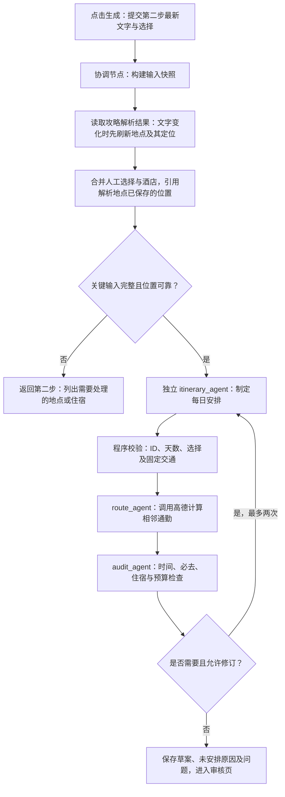

# 交通选择、分类地点与攻略驱动的行程 Agent

日期：2026-10-29。状态：设计提案，待用户审阅；尚未修改产品代码。

## 需求与范围

用户要求第一步从“选交通和酒店”改为“选交通”，允许选择交通工具；酒店移入第二步“选活动与攻略”。地点按游玩地点、吃饭地点、酒店、其他分组，默认自动确认位置并显示地图。生成路线交给独立行程 Agent，必须使用第二步最新的“识别文字”和已识别、已选择的地点。

用户已确认交通工具包含火车、飞机、自驾、大巴。下文其他具体实现选择均为本次提案，待审阅。沿用 React、FastAPI、LangGraph、现有模型客户端及高德接口，不增加依赖或部署服务。

用户补充确认：工作流中的地点位置应直接来自攻略解析出的地点所关联的定位结果。自动定位属于第二步攻略解析处理链路；生成路线时读取这些已保存的位置，不另起一套根据地点名称重新搜索或猜测坐标的流程。

## 现状及问题

- `frontend/src/GuidedPlanner.jsx`：第一步要求同时选择往返交通和酒店；第二步只有一张活动列表。生成时先保存 choices，再以空 payload 调用 draft，文本框尚未保存的编辑不会进入规划。
- `service/travel/planning.py`：候选生成同时生成交通及酒店，`select_candidates` 要求多日游选酒店；`draft_itinerary` 按 must 优先、列表顺序和每日数量分配，不理解攻略的指定日期、时间或路线顺序，所有活动均变成 attraction。
- `agent/planning_graph.py`：已有 coordinator、guide_agent、activity_agent、route_agent、audit_agent。route_agent 是规则排程加地图通勤计算，并未调用模型制定行程。
- `frontend/src/PlacePicker.jsx`、`service/travel/map_planning.py`：已有 POI 搜索、位置详情和静态地图缓存；目前需要逐地点手动确认。
- 攻略识别通过 `service/travel/guide.py` 读取 `.agents/skills/guide-recognition/SKILL.md`，应扩展同一结构化识别契约，保留原文和稳定地点 ID。
- 工作区已有大量未提交变更；实施时在这些现有文件基础上做增量修改，不覆盖或回退它们。

## 实现路径比较

1. **推荐：在现有 LangGraph 中增加专职 itinerary_agent。** 模型理解攻略、输出每日安排；独立工具节点计算真实通勤；程序校验并允许有限修订。复用当前状态、存储、API 和审核页，改动集中。
2. **独立 Agent 服务。** 可以拥有自己的任务队列和部署，但需要新增协议、状态同步及运维，当前需求不需要，暂不采用。
3. 仅把现有规则函数改名为 Agent 无法理解攻略约束，不满足需求，不作为实现方案。

本稿按方案 1 展开，方案尚待用户批准。

## 页面行为

### 第一步：选交通

- 步骤栏及相关按钮统一改成“选交通”“查询交通候选”“确认交通，继续”。页面只展示交通。
- 去程、返程分别选择交通工具：火车、飞机、自驾、大巴；火车、飞机、大巴可以自由组合。自驾视为自有车辆往返整体方案，选择任一方向自驾时另一方向同步切换为自驾，界面明确说明。切换后清除不兼容的已选候选。本次不隐含租车、异地还车或车辆托运。
- 火车、飞机保留当前模拟候选，明确标明模拟班次、时间和价格。大巴也明确为模拟方案，不能冒充实时班次。
- 自驾没有航班/车次候选；选择自驾方案，使用高德驾车路线估算时长、距离，允许填写出发时间和车辆数，燃油与路桥费未知时显示待补充，不能当作零费用。自驾费用按车辆计，其他交通按人数计。
- 往返方案选择完成即可进入第二步；此时不检查是否已经选酒店。
- 城际工具与市内通勤分开存储。自驾到目的地时市内默认驾车，其余默认公共交通；审核页仍可逐段修改已有通勤方式。
- 旅行天数沿用当前含出发日和回家日的口径，end_date 是回到家的日期。第一版仅支持当天到达的城际方案；计算出自驾到达跨日时明确提示当前不支持该方案，要求调整出发时间或改选交通，不能截断时间或暗改旅行日期。首日到达、末日返程时间直接限制可游玩窗口。

### 第二步：选活动与攻略

- 上方保留上传图片和可编辑的“识别文字”，按钮改为“识别地点与要求”；原文中的第几天、上午/晚上、先后顺序、停留时长、用餐和住宿要求应进入规划。
- 地点分为 **游玩地点 / 吃饭地点 / 酒店 / 其他**，空组也展示入口。每个地点可修改分类、必去/可选/不去、时长和备注；手动新增也必须可选分类。
- 酒店组同时容纳攻略识别酒店、地图推荐酒店及手动酒店。显示地图和住宿估价；选择一个作为本次行程住宿，其他酒店作为候选而不排进景点列表。
- 第一版一次旅行使用一个住宿酒店，入住为首日、退房为末日，沿用现有锚点和预算模型。若原文要求换酒店，展示明确冲突交用户调整，不能静默丢弃要求。多酒店按日分配不属于本次实现。
- 一日游不强制酒店；多日游在第二步生成前要求选定住宿。酒店估价继续标注模拟，已购金额保留并优先参与预算。
- 其他地点可以是商店、集合地点等普通停留点；根据原文和用户选择排程，不伪装为景点或酒店。
- 生成按钮直接提交当前文本、地点选择、分类及住宿，不能依赖用户先点一次识别/保存。若文字有变化，先刷新第二步攻略解析结果，由解析链路为新增或变更地点补齐定位，再将更新后的地点及位置交给行程 Agent；文字未变时直接复用已保存的解析结果和位置。

### 默认定位与地图

- 攻略解析先识别具体地点，再由该解析链路按目的地城市、原文中的具体名称及地址查询高德 POI，将可靠定位绑定到对应地点的稳定 ID 并保存，生成静态地图，卡片默认展开显示。模型负责提取地点及地址线索，坐标来自地图定位结果。
- 解析结果包含地点分类、原文依据及关联位置（POI ID、地址、经纬度、定位状态、地图缓存 key）。第二步展示、行程 Agent 及路线计算读取同一份地点位置；生成阶段不对这些地点重新按名称搜索。地图推荐和手动新增地点也在第二步补齐并保存同样的定位信息。
- 优先使用已经返回的确定 POI ID；纯文本检索必须校验城市、名称、地址。唯一同城精确匹配可自动绑定；多个同名或分店结果标记“位置待核对”，展示候选，不默认取第一条。
- 定位状态区分自动确认、手动确认、歧义、查询失败。手动确认优先，刷新推荐、重新解析或生成路线不能覆盖。
- 匹配 POI 和绘制地图分开处理：地图图片失败仍保留已确认位置及地址，并可重试图片；查询失败保留地点和原因，并允许修改搜索词。
- 关键未定位地点（必去点、当前住宿）阻止生成正式路线并指出待处理项；可选点无法定位则列入未安排清单并说明原因，不能编造坐标。
- 酒店与其他地点共用定位能力。沿用 GCJ-02、现有地图图片接口和缓存 key，不将图片 base64 写入计划。

## 行程 Agent 工作流

### 1. 协调与输入快照

一次 draft 请求包含当前文本、choices、分类、selected_hotel 及允许的酒店/交通编辑；后端加载现有计划并验证全部 ID。生成期间禁用重复提交。记录本次输入摘要，后续修改使旧路线标为过期。

输入快照包括目的地、出行日期、人数、预算、节奏、兴趣、限制，往返交通工具及真实或模拟时刻，家和酒店位置，地点稳定 ID、坐标、分类、选择和停留时长，完整原文和结构化攻略要求。重新解析时按稳定 ID 合并人工选择、人工定位、分类及已购记录；新地点显示为可选，被排除地点不能因重新识别复活。

其中攻略地点位置通过稳定地点 ID 从第二步解析结果读取，不按显示名称重新匹配。已有可靠定位直接复用；未定位或存在歧义时返回第二步对应地点处理，显式重试也沿用该地点的定位入口。若原文修改影响同名地点的城市或地址，则在解析阶段将旧自动定位标记过期并重新定位，不能复用错误坐标；手动确认的位置保留并提示用户核对冲突。

### 2. 攻略理解

扩展现有模型识别输出以保留 `category` 和 `constraints`，每个约束包含类型、关联地点 ID、值、原文依据和强弱。例：第 2 天西湖、灵隐寺在河坊街之前、晚上去夜市、午餐餐厅、停留两小时。未写明的开放时间、价格、票务和预约状态保持未知。

攻略解析处理链路为“原文 → 具体地点及分类、地址线索、要求 → 对已解析地点自动定位 → 保存地点和位置 → 第二步展示地图”。名称和分类来自原文解析，位置由地图工具校验；不是让模型直接生成经纬度。已保存的地点位置是下游排程及计算路线的来源。

若原文和用户当前操作冲突，以用户显式选择、已选交通及住宿优先，并在结果中列出无法满足的原文要求。原文视为数据，不能改变系统指令、调用任意工具或修改其他计划。

### 3. 独立 itinerary_agent

这是应用内独立模型节点，使用现有模型配置及客户端，并有专门的提示词和结构化输出验证，不是给规则函数改名。它不能直接写数据库；只返回安排提案。

输出包含每日停留序列 `activity_id/day/start_time/duration_minutes/reason`、`unscheduled`、`assumptions` 和 `constraint_results`。只允许引用本次输入的地点 ID，不能发明地点、价格、坐标或交通班次。酒店作为每日出发/返回锚点，由程序插入，不能当作景点反复游玩。

规划规则：固定往返交通及站点接驳；以酒店为中间日首尾；优先覆盖必去地点；依据坐标把相近地点排在同一天；尊重原文明示的日程、顺序、时间段与时长；吃饭地点按午晚餐安排；根据轻松/适中/充实控制负荷。可选点放不下时解释；必去点放不下须报冲突，不能静默漏掉。

### 4. 路线计算、审核及有限修订

route_agent 按提案中的地点 ID 引用第二步已保存的 POI 及经纬度，只负责计算相邻停留点的地图路线、耗时及明细，不再根据地点名称重新查找位置。家、车站或机场等固定交通锚点使用其单独确认的位置。程序组装固定交通与住宿锚点，再依据真实通勤校验排程；不能把明确指定时间简单向后挪动后就声称满足原文。

审核验证日期和时间合法、ID 属于当前计划且无非法重复、排除点未入选、必去覆盖、住宿首尾、接驳及交通缓冲、原文硬约束、预算计价单位与重复计费。饭店实际费用替换相应餐饮预算额度，酒店只按晚计费，不能同时作活动再次收费。

可修复的排程冲突携带结构化问题反馈给 itinerary_agent，最多再修订两次。模型格式错误也占用此修订预算。超限后保留明确问题进入草案审核，存在严重问题禁止最终确认。工具失败不通过反复调用模型修复；路线失败显示估算来源及原因，不能标成已核实。

模型超时或最终无有效提案：返回可重试错误并保留上次成功行程，不回退为假装成功的固定规则行程。没有原文时，Agent 依据用户选点及旅行要求生成，并标明相关假设。没有实际游玩点时，可以生成交通、住宿和用餐安排，说明空闲时间。

### 5. 保存与用户反馈

成功生成后一次性保存完整输入、结果、审核和 trace；内部节点只操作副本。前端进入现有审核页，展示每日地图、时间线、费用、未安排地点、攻略要求满足情况及调整理由。

本次先沿用现有同步 API，不新增后台任务系统。调用设置超时和明确的失败提示；按钮显示“正在根据攻略规划行程…”。不展示同步 API 尚未提供的虚假逐节点实时进度。

## 数据与接口变更

- `planning.activities[*].category` 使用 `attraction / food / hotel / other`；旧数据缺失分类按 attraction 兼容，旧 selected_hotel 转为酒店组中的住宿选择，并保留原 ID 和购买关联。
- 交通 `kind` 扩展为 `train / flight / drive / bus`，UI、行程标题、行程单和计价统一使用映射，移除“不是飞机就是火车”的二分判断。
- `selected_transport` 保持按去返程存 ID；自驾/大巴也使用被服务端验证的方案对象，禁止直接信任客户端报来的费用或时长。
- 已有 `hotel_candidates / selected_hotel` 暂时保留作计价与兼容来源；与第二步酒店组由同一更新函数同步，禁止出现两个互不相关的住宿选择。
- 增加 `guide_constraints`、`generation`（输入摘要、模型、修订次数、假设、未满足要求及未安排原因）、定位状态。均在已有 planning JSON 内存储，无新建独立数据库表。
- 攻略解析结果通过稳定 ID 对应到 `planning.activities[*]`，位置统一保存在该地点的 `place` 字段；原文提取记录保留关联 ID，不维护可独立变化的第二份坐标。地点列表、地图及 Agent 输入按 ID 引用此处的位置。
- `choose_candidates` 仅校验并保存交通；第二步保存并校验酒店。重新查询交通不得清空地点、酒店、原文或购买记录，应标记旧路线过期。
- `draft` 接收完整第二步快照并走新工作流；现有无 payload 的调用兼容已保存输入。`add_activity / choose_activities / resolve_place` 扩展分类及定位处理，酒店也能解析位置。
- 保留 move_activity、route_mode、transport_stops、purchase 及行程打印行为。手工拖动和逐段改交通仅重算受影响路线并审核，不自动重新调用模型重排整份行程；用户可明确点击重新生成。
- 所有可移动停留点判断统一覆盖 attraction、food、other，包括审核页、待安排池、重排、时间更新及元信息编辑；酒店和固定交通仍由锚点规则管理，不能继续把所有非 attraction 项当作不可移动锚点。地图标记、每日统计及游玩时长显示按分类呈现。

## 修改范围

- 前端：GuidedPlanner、PlacePicker、ReviewPage、guided-planner.css；同步行程单及交通工具文案。
- Agent：planning_graph 加 itinerary_agent、输入准备和受限修订分支；模型提示词及结构化输出处理独立放置在 agent 层。
- 领域：planning 的候选选择、分类合并、行程组装和预算；guide 的抽取契约；map_planning 的自动定位；itinerary_audit 的分类及攻略约束校验。
- API：现有 planning action payload 和错误信息；继续在完成后保存一次。
- 测试：guided_planning、guided_graph、guided_api、map_review、budget_reporting、itinerary_schedule；使用模拟模型和高德返回，避免依赖实时价格和外部可用性。

## 验收例子

1. 第一步选择火车去、飞机回，未选酒店也能进入第二步；自驾和大巴均可选择且文案、计价正确。
2. 文本“D1 雷峰塔，午饭知味观；D2 上午灵隐寺，晚上河坊街；住某酒店”产生四类地点，位置可靠时自动显示地图，酒店不会排作景点。
3. 点击生成前直接把识别文字改成“第二天先去灵隐寺，再去西湖”，不另点保存，Agent 收到的就是新文字，并在结果中落实或解释冲突。
4. 手动改分类、排除一个地点、换一个 POI 后重新识别，不丢这些选择，排除点不出现在路线。
5. 同名酒店有两个候选时显示位置待核对；地图图片失败不清除已确认坐标。
6. 必去地点与返程时间冲突时有限修订，仍冲突则明确说明且不能确认；不会暗改返程或删掉必去地点。
7. 已购机票或酒店重新规划后保留原始金额和关联，不重复计算酒店、饭店及日常餐饮预算。
8. 模型返回非法 ID、重复点、越界天数、非法时间或非 JSON 时受控失败；旧行程保留。
9. 原文为空但有已选地点仍可由 Agent 规划；高德不可用时提示位置或路线问题，不伪装为已核实。
10. 审核页拖动地点、更改市内工具、打印行程和旧计划加载仍可使用；前端 build 和相关回归测试通过。
11. 选择自驾时往返同步选中，按车辆估算且说明费用未知项；自驾到达跨日会明确拒绝该方案，旅行日期、酒店晚数及原计划不被暗改。
12. 攻略地点在第二步已定位后，生成及修订路线直接使用同一地点 ID 对应的坐标；断言不会再次按该地点名称查询 POI。同名分店的人工选择必须原样传给路线计算。修改原文新增地点时，仅由攻略解析链路补充该地点的定位。

## 本次边界

不接入真实机票、大巴或酒店预订，不自动付款，不新增多酒店换住、跨日城际交通、单程自驾车辆处置和后台队列。单酒店、同日到达和自驾往返绑定是本稿为沿用当前旅行日期及住宿模型提出的边界，并非用户已经指定。价格继续明确显示模拟/估算/待补充。真实模型及高德联调须在实施后使用项目实际配置验证，本设计阶段未发出外部调用。
